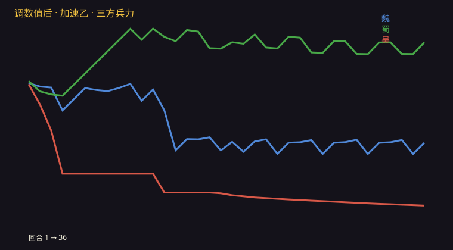
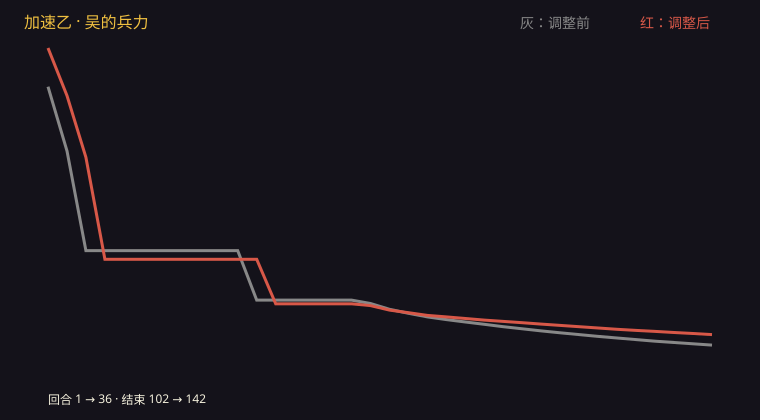
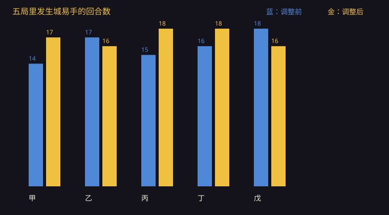
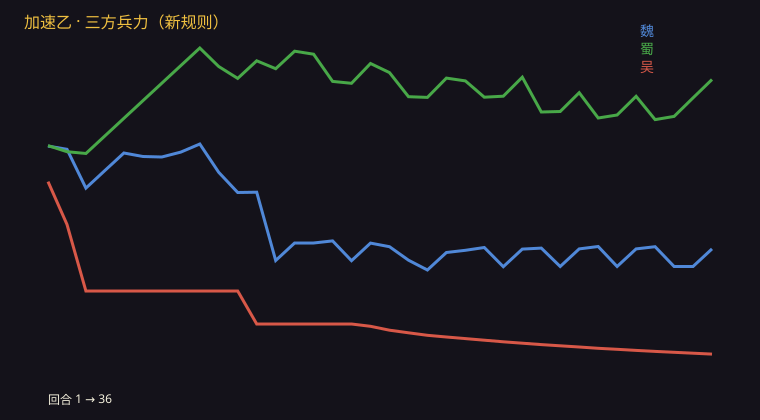
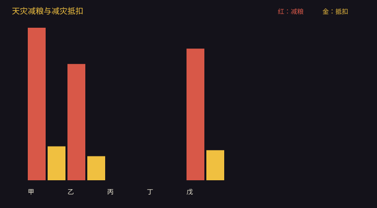
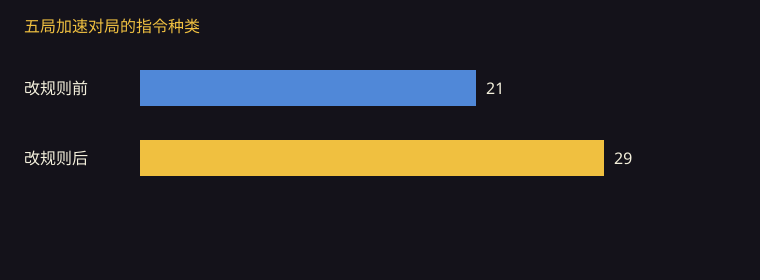

# 六席推演报告

六个 Bot 只坐历史人物，其余席位空着。每人每回合先交出一份菜单指令，再交给和真人相同的 `parseOrder`。解析失败就改成合法的保底指令，不会直接改城池或兵力。随机数只用局号、回合和人物编成的固定种子。开局时刻是 2026-11-12 08:00（上海）。

| 席位 | 人物 | 策略 |
|---|---|---|
| 魏君 | 曹操 | 好战。能打就打无主城或较弱的邻城，结盟一律拒绝 |
| 蜀臣 | 诸葛亮 | 内政。屯田、开发，并与刘备结义；邻城有敌就准备单挑 |
| 魏臣 | 荀彧 | 防灾。按本回合和下一回合的公开天气修堤、积谷、开渠、医营、赈济 |
| 吴君 | 孙权 | 外交和守成。送结盟，接受结盟与停战，拒绝称臣，只打无主邻城 |
| 蜀将 | 张飞 | 乱按。先试几条非法指令，再在合法菜单里随机 |
| 蜀君 | 刘备 | 看天气。雪天不出兵，雨天和涝不走渡口，旱天开渠 |

经典档一回合 24 小时，所以真实的一天只结算 1 回合。那一回合太短，另外用同一套规则加速打了 5 局，每局最多 36 回合（等于 36 个游戏日），或者直到统一。五局都没有统一。

本地再跑：

```bash
npm test
npm run sim
```

`npm run sim` 把摘要打在终端。改规则前的摘要在 `docs/playtest-baseline.json`。

## 真实的一天

局号 `sim6-day`。天气是春、晴，没有天灾。曹操、刘备、孙权各打下一座无主邻城，三家都变成 2 城。没有人退场。18 点行动改规则前用了 17 点，改规则后 18 点都用上。指令里多了 2 次结义，少了搜罗和一次驻守。结算大约 3 毫秒。

这一天看不出统一，也看不出灾害。下面的判断都来自五局加速对局。

## 改规则之前

五局都打满 36 回合，没有统一，没有人战死。结束时魏 3 或 4 城，蜀 3 或 4 城，吴只剩 1 城，吴兵大约 250 到 270。

| 项 | 五局 |
|---|---|
| 城池连续不变的回合 | 19–21 回合，最长 5–7 回合。大约 57% 的回合没有易主 |
| 指令种类 | 21 种 |
| 行动点没用完的比例 | 约 6.4% |
| 史书里除了驳回、天气和缺席之外的行数 | 每回合大约 19.6 行 |
| 天灾 | 甲局 1 次蝗，减粮 916，义仓抵 376。乙局涝和瘟疫，减粮 735、减兵 178，堤防少损 91、义仓抵 59、医营少损 41。丙、丁没有天灾。戊局 1 次涝，减粮 785，堤防少损 180、义仓抵 134 |
| 每回合结算 | 平均 0.5–0.6 毫秒，最慢 3.3 毫秒 |
| 不变量 | 没有负粮、负兵、超上限、死人行动或史书序号倒退 |

天气在甲局是晴 13、雾 8、雪 6、雨 5、旱 4。灾害大约每 30 多回合才有一次，和千分之 35 的公开概率相符。减灾在真的碰到涝、蝗、瘟疫时抵得掉一部分，碰不到就只是在攒等级。

无聊的地方很明显：无主城在前几回合被分完，之后大段回合只有屯田、开发和「驻守」。孙权的结盟因为没人回复而每回合重复。张飞点的确认、请假、拒绝大多没有后文。金一直增加，没有花处。

## 改规则之后

同一批局号再跑一遍。仍然没有统一，也没有战死。结算没有不变量错误。平均每回合 0.8–1.5 毫秒，最慢一次 9.4 毫秒。

| 项 | 改前 | 改后 |
|---|---|---|
| 僵持回合（五局平均） | 20.4 / 36（57%） | 20.0 / 36（56%） |
| 最长连续不换城 | 7 | 6 |
| 指令种类 | 21 | 29 |
| 行动点浪费 | 6.4% | 5.0% |
| 史书有效行 / 回合 | 19.6 | 22.6 |

新出现的指令是结义、离间、火攻、伪报、犒赏、单挑，以及孙权终于收到的回复。甲局 36 回合里单挑 36 次、离间 35 次、犒赏 21 次、结义 11 次。火攻只在旱天或秋晴点得着，甲局 6 次。

僵持几乎没缩短。城还是分完就停。多出来的行数里，有一部分是每回合那条季节悬赏，不是每次都改了地图。选择确实多了：僵持的时候可以离间、伪报、犒赏、结义，而不是只屯田。

上面的行数取自悬赏还写在结算中途的那一版。后来把公布挪到开局和每季结束，玩家锁定指令之前就能看见目标。真实一天再跑一遍，有效行仍是 23。每回合还是一条悬赏，没有为了把数字做高而多写一行。

吴的兵力从大约 270 掉到大约 110，五局仍是 1 城。未入席的周瑜现在会把统率算进守城，但离间掉民心之后，流民又从低民心的城搬走 5% 的兵和粮。雪球没有消失，低民心的一方还被多抽了一层。这是建议降数值的理由，不是再给吴开一扇暗门。

## 平衡建议

下面五项已经写进默认配置。取舍和同一批局号的回归见下一节。

1. 无主城守军从 560 调到 850。
2. 守成从 7 回合调到 4 回合。稳定回合仍是 4，控制比例仍是 0.6。
3. 建业开局兵力从 1300 调到 1500，和许昌一样。成都仍是 1400。
4. 流民比例从 0.05 调到 0.03。触发民心仍是 36。
5. 单挑分差仍是 8。败者勾了亲身且分差达到 8 才退场。

## 默认数值调整之后

调整前的这一轮，用的是人事规则已经加上、悬赏改到季初公布之后的代码，局号仍是 `sim6-day` 和 `sim6-a` 到 `sim6-e`。六局都没有不变量错误，也没有人战死。

守成只改 7 到 4，稳定回合留在 4。稳定回合回答的是「这版图是不是刚打下就反弹」。四回合正好一轮四季，这个检查还在。上一轮把统一推到 36 回合之外的，是窗口打开之后还要再守 7 回合。7 回合将近两轮四季，改成 4 回合，守成也是一轮四季。控制比例保持 0.6，没有往 0.9 靠。

流民只改比例，不改触发线。民心掉到 36 以下仍然会走，赈济还来得及看见。若把线降到 28，流民要等到民心已经崩了才出现，这条规则会在大多数回合里沉默。比例从 5% 降到 3%，掉队的一方少被抽走一层，触发时机不变。

### 统一

六局都没有统一，也没有进入守成。真实一天结束时魏 2 城，蜀、吴各 1 城。五局加速对局里，任何一方最多同时占 4 座城。十二城的 60% 是 8 座。另外两家既没有称臣，也没有出局。窗口根本没开，所以守成从 7 改成 4 还没有被用到。

### 僵持、易手、吴

| 项 | 调整前 | 调整后 |
|---|---|---|
| 统一 | 0 / 6 | 0 / 6 |
| 僵持回合（五局平均） | 20.0 / 36（56%） | 19.0 / 36（53%） |
| 最长连续不换城 | 6 | 5 |
| 城易手的回合（五局合计） | 80 | 85 |
| 平均每局易手回合 | 16 / 36（44%） | 17 / 36（47%） |
| 吴的结局 | 五局都剩 1 城，兵力 102–109 | 五局都剩 1 城，兵力 142–156 |
| 指令种类 | 29 | 29 |

吴没有出局。加速甲、丙、丁里，吴中途占到过 3 座城，后来又退回建业。调整前吴几乎从第 6 回合起就只守一座城。兵力谷底从大约 110 抬到大约 150，没有再被流民抽到一百上下，也没有因此保住第二座城。

真实一天的指令种类和次数与调整前相同，都是 3 次出征。结果不同：调整前三家各下一座无主城；调整后只有魏打下一块。蜀、吴攻到 850 的守军，没有破城，残部退回本城。吴的兵力停在 1259，而不是出征前的 1500，也不是把人留在城外。

指令种类没有变化。这五项都是数字，没有新菜单。同一批策略仍在用结义、离间、火攻、伪报、犒赏和单挑。



加速乙在新默认数下的兵力。蜀仍是最高的一方，吴贴在底部，但没有再掉到调整前那条线的尽头。



同一局加速乙。灰线是调整前，红线是调整后。红线从更高的开局出发，第 4 回合一度低 33，结束时是 142，调整前是 102。



五局里发生城易手的回合数。金柱是调整后。甲、丙、丁多了几次易手，乙和戊少了一次。合计从 80 次增到 85 次。

## 去向菜单之后

同一批局号又跑了一轮。结算公式、回合时长和空席规则没动。Bot 多了三条脚本，都走公开菜单：只剩一座城且该城兵力低于 700 的君主，向城更多、并且君主在席的势力提出臣服；收到臣服、投降、投奔或出仕的君主一律同意，别人要求自己称臣仍然拒绝；张飞大约两成回合向魏投奔。真人不会被这些脚本替答。

真实一天仍是 1 回合。魏 2 城，蜀、吴各 1 城，兵力 1265 / 1257 / 1259，和上一轮相同。张飞写了投奔，但要下一回合才有人能答，所以这一天没有人换主。

| 局 | 回合 | 结局 | 结束时城数（魏/蜀/吴） | 吴兵 | 臣服指令 | 不变量 |
|---|---|---|---|---|---|---|
| 真实一天 | 1 | 进行中 | 2 / 1 / 1 | 1259 | 0 | 0 |
| 加速甲 | 23 | 魏统一 | 4 / 3 / 1 | 223 | 4 | 0 |
| 加速乙 | 36 | 进行中 | 4 / 3 / 1 | 142 | 2 | 0 |
| 加速丙 | 24 | 魏统一 | 4 / 3 / 1 | 212 | 4 | 0 |
| 加速丁 | 23 | 魏统一 | 4 / 3 / 1 | 216 | 4 | 0 |
| 加速戊 | 36 | 进行中 | 3 / 4 / 1 | 153 | 2 | 0 |

五局加速里三局统一，都是魏。甲、丙、丁在第 23 或 24 回合进入纪念馆。乙和戊打满 36 回合，臣服只提出了两次，控制比例没有同时凑齐都城和 60%。没有人战死，没有解析失败，没有粮兵为负或臣服成环。吴在没统一的两局里仍是 1 城，兵力 142 和 153。统一的三局更早结束，吴兵停在 212 到 223，不是又被结算扣没了。

僵持回合在提前结束的局里变短：甲 12、丙 13、丁 12；乙 19、戊 21。上一轮五局平均大约 19 个回合城池不动。这一轮能统一，是因为脚本会在只剩一座弱城时主动臣服，不是因为空席替人答应。

## 臣服表决之后

同一批局号又跑了一轮。结算公式、回合时长、空席规则和统一门槛都没动。臣服多了一道表决：在席一人一票，赞成必须超过 2/3，刚好 2/3 不通过。投降仍然不表决。

脚本在原有「只剩一座弱城才臣服」之外，加了一条只为把表决跑到：第 2 回合起，在席不少于两人、而且这名君主还没发起过的，会提出一次臣服。荀彧、诸葛亮投赞成，并写明若未通过就投奔城更多的一方。张飞投反对，并写明若通过就下野。对方君主仍要亲自同意，这一回合没答，要约就过期。

真实一天仍是 1 回合，表决还没开，所以和上一轮一样：魏 2 城，蜀、吴各 1 城，兵力 1265 / 1257 / 1259。张飞写了投奔，要下一回合才有人能答。

| 局 | 回合 | 结局 | 结束时城数（魏/蜀/吴） | 吴兵 | 表决 | 不变量 |
|---|---|---|---|---|---|---|
| 真实一天 | 1 | 进行中 | 2 / 1 / 1 | 1259 | 还没开 | 0 |
| 加速甲 | 36 | 进行中 | 4 / 3 / 1 | 164 | 魏 2/2 通过，蜀 2/3 不通过 | 0 |
| 加速乙 | 36 | 进行中 | 3 / 4 / 1 | 150 | 魏 2/2 通过并成为蜀的附庸，蜀 2/3 不通过 | 0 |
| 加速丙 | 18 | 魏统一 | 4 / 3 / 1 | 259 | 魏 2/3 不通过，蜀 2/2 通过，吴 2/2 通过 | 0 |
| 加速丁 | 36 | 进行中 | 4 / 3 / 1 | 159 | 魏 2/2 通过但蜀未在限期内答复，蜀 2/3 不通过 | 0 |
| 加速戊 | 36 | 进行中 | 4 / 3 / 1 | 160 | 魏 2/2 通过并成为蜀的附庸，蜀 2/3 不通过 | 0 |

五局里都能看见通过和不通过。甲、乙、丁、戊的蜀是刘备、诸葛亮赞成，张飞反对，2/3 不算超过 2/3。魏在这四局里是曹操、荀彧都赞成，2/2 通过。乙和戊里蜀的君主在下一回合同意了，魏成为附庸，城仍记在魏名下。甲和丁的那张要约过了回复期，没有生效。丙里张飞在计票前已经被魏收下，他的反对票对不上蜀的席，蜀改成 2/2 通过；魏的席上多了他、他却没投魏的票，变成 2/3，不通过。吴只剩孙权时不表决，直接送出；丙里荀彧先投奔了吴，吴变成两人，后来 2/2 通过。

赞成者离开发生了。诸葛亮在表决未通过后向魏投奔，甲、乙、丁、戊都在下一回合被收下，人成为魏的军师，不带走兵力。丙里未通过的是魏，荀彧因此投奔吴，也被收下。

反对者下野没有出现在这六席里。张飞写了「若通过则下野」，可他投反对时，三个人里两张赞成刚好是 2/3，表决不通过，这条附带不去执行。六席的编制里，没有任何一势力能在有人反对时仍超过 2/3：魏最多两人，蜀三人。反对者下野由单独的测试覆盖：四名在席，三张赞成，关羽反对并下野，人变成在野，势力仍把臣服要约送给对方。张飞后来几次投奔魏，是他原有的大约两成回合随机投奔，不是表决通过后的不随行。

没有人战死，没有解析失败，没有粮兵为负、史书序号倒退或臣服成环。丙在第 18 回合统一，是蜀、吴先后臣服，城计入魏，再守成，不是空席替人答应。

## 图表



加速乙在新规则下的兵力。蜀稳住，魏来回，吴掉到谷底后几乎不再回来。



这张图是改规则之后的五局。天灾减粮（红）和堤防、义仓、医营抵掉的量（金）。甲局减粮 913、义仓抵 203。乙局减粮 696、减兵 181，堤防少损 62、义仓抵 41、医营少损 41。戊局减粮 788，堤防少损 103、义仓抵 77。丙、丁没有天灾，金条是零。抵扣小于总损失，减灾没有变成免疫。



改规则前 21 种指令，改规则后 29 种。
